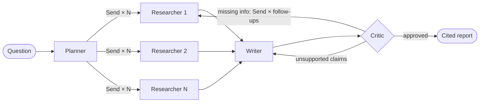

# ResearchCrew

[](https://github.com/khush-ahuja/ResearchCrew/actions/workflows/tests.yml)

A multi-agent research assistant built with **LangGraph**. Ask a question and a small team of agents answers it with a cited report:

- a **planner** splits the question into focused sub-questions
- **researchers** run in parallel, one per sub-question: they search the web, read the top pages and extract facts with their source URL
- a **writer** merges the notes, de-duplicates sources and writes a brief where every claim carries a `[n]` citation
- a **critic** checks the brief against the sources and either approves it, asks the writer to fix unsupported claims, or sends new sub-questions back to the researchers

Every step is traced (what it did and how long it took), so you can see how the answer was built.



## Why it is built this way

| Design choice | Reason |
|---|---|
| Parallel researchers via LangGraph `Send` (map-reduce) | Sub-questions are independent, so they run at the same time; notes are combined with a list reducer |
| Facts are extracted per page, with the URL attached | The writer only sees facts that came from a real page, which makes citations checkable |
| Sources are de-duplicated and renumbered by first citation | Clean `[1] [2] [3]` order in the final report; citations to sources that don't exist are removed and flagged |
| Critic loop with a revision limit | Catches unsupported claims and gaps without risking an endless loop |
| No sources found → says so | It does not ask the model to answer from memory |
| Search and fetch are plain interfaces | DuckDuckGo (no key) or Tavily in production; offline fakes in tests |
| Failures are contained | A failed search or unreadable page is logged in the trace and the rest of the crew carries on (falls back to the search snippet) |

## Quick start

```bash
git clone https://github.com/khush-ahuja/ResearchCrew && cd ResearchCrew
pip install -r requirements.txt
cp .env.example .env          # add a free Groq key, or set LLM_PROVIDER=ollama to run locally

python cli.py "How do vector databases differ from traditional databases?"
python cli.py "What is LoRA fine-tuning and when should I use it?" --out lora.md
streamlit run app.py          # watch each agent's step live
```

Use it from Python:

```python
from researchcrew import research
from researchcrew.report import to_markdown

print(to_markdown(research("What are the main approaches to evaluating RAG systems?")))
```

## Output

The report contains the brief with renumbered citations, a **Sources** list with only the sources actually cited, a warning if the critic still had concerns after the last revision, and a collapsible **Agent trace** in this format (illustrative timings):

```
- plan (0.6s): 3 sub-questions: ...
- research (4.1s): 'What is ...': read 3 pages, 11 facts
- research (3.8s): ...
- write (2.2s): 7 sources
- critique (1.1s): 1 issues, 1 follow-ups
- research (3.0s): ...
- write (2.4s): 9 sources, revised
- critique (0.9s): approved
```

## Tests

```bash
pytest
```

17 offline tests use a scripted LLM, a fake search engine and a fake web, so they run in under a second with no API keys. They cover:

- one parallel researcher per sub-question
- URL de-duplication within and across researchers
- fallback to the search snippet when a page can't be read
- a failed search not crashing the run
- an honest "no sources" answer
- critic follow-ups triggering new research and a rewrite
- critic feedback reaching the writer
- the revision loop staying bounded
- citation renumbering and removal of invented citations
- HTML cleaning

CI runs ruff and the tests on Python 3.10–3.12.

## Project layout

```
researchcrew/
  graph.py     LangGraph workflow: planner, parallel researchers, writer, critic
  prompts.py   one prompt per agent
  tools.py     web search (DuckDuckGo / Tavily) and page fetching
  report.py    citation renumbering and Markdown report
  llm.py       Groq / OpenAI / Ollama chat model + tolerant JSON parsing
cli.py         command line
app.py         Streamlit UI with live agent steps
tests/         offline tests
```

## Tech

Python · LangGraph · LangChain · Groq / OpenAI / Ollama · DuckDuckGo / Tavily search · httpx · BeautifulSoup · Streamlit · pytest · GitHub Actions
